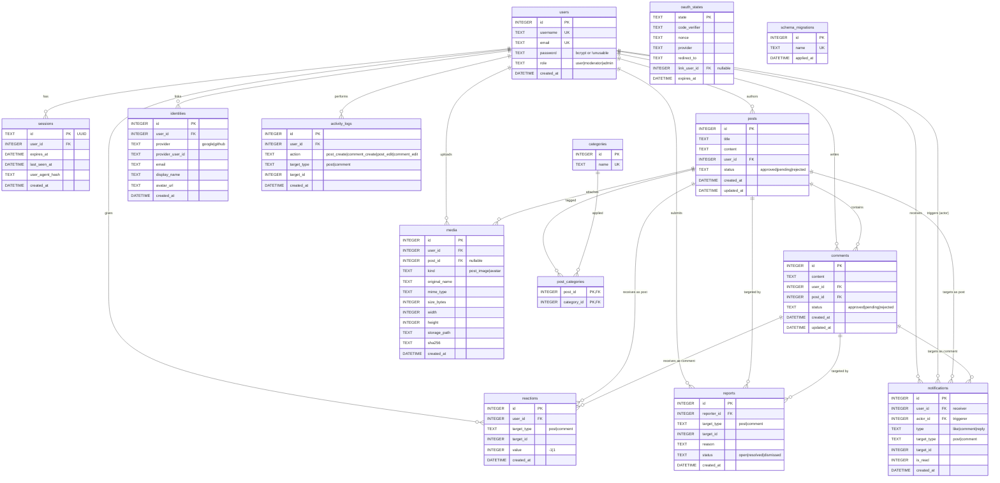

# Entity-Relationship Diagram (ERD)

## Visual Diagram

## Table-by-Table Explanations

### Core & Authentication
- **`users`**: Stores local accounts. The `role` column enables RBAC (User, Moderator, Admin). SSO-only users have a password starting with `!`, making local login impossible.
- **`sessions`**: Server-side session store. Includes `last_seen_at` for idle timeouts and `user_agent_hash` to prevent session hijacking (cookie theft).
- **`identities`**: Links external providers (Google, GitHub) to local users. Enables multiple SSO methods per account.
- **`oauth_states`**: Single-use, TTL-bounded store for OAuth `state`, `code_verifier` (PKCE), and `nonce`.

### Community Content
- **`posts` & `comments`**: Core content. The `status` column allows moderators to approve or reject content. The `updated_at` column enables optimistic locking (preventing stale edits).
- **`categories` & `post_categories`**: Many-to-many relationship for subforums.
- **`reactions`**: Unified table for likes/dislikes on both posts and comments.

### Moderation & Advanced Features (F05 & F06)
- **`reports`**: User-generated reports against posts or comments. Moderators can resolve or dismiss them.
- **`notifications`**: Triggered when a user likes or comments on someone else's content. Links an `actor` (who did it) to a `user` (who receives it).
- **`activity_logs`**: Tracks user actions (post creation, edits, comments) for the personal activity feed.

### Media
- **`media`**: Stores uploaded images. Paths are SHA-256 addressed (content-addressed storage). `post_id` is nullable to support standalone avatars.